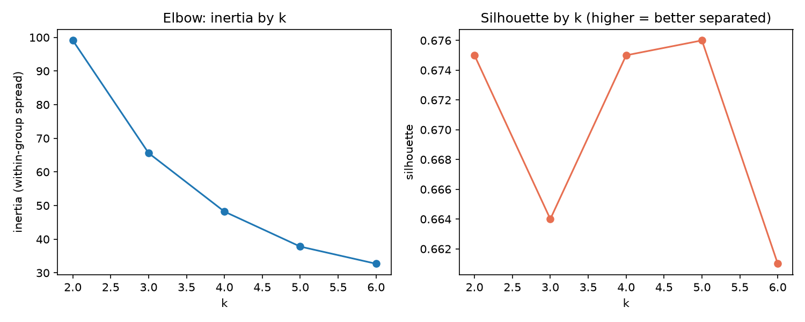
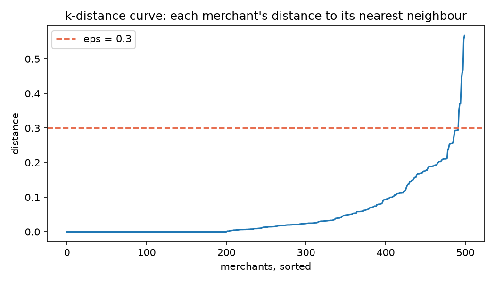
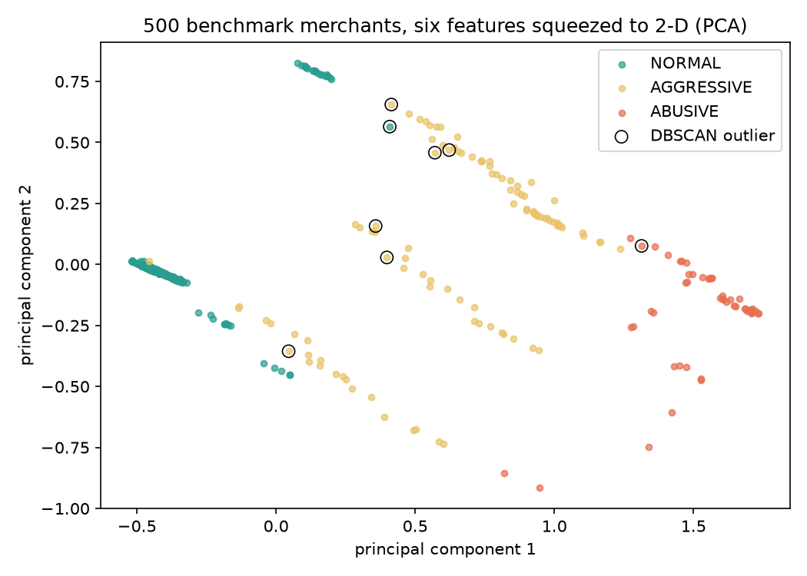

# ML evaluation on the labelled benchmark

Generated by `python ml/evaluate.py` from `ml/data/benchmark.csv` (built by `npm --prefix api run benchmark` with the real pipeline).

**Data:** 500 synthetic merchants, 350 normal, 100 aggressive and 50 abusive. They are synthetic, so the true answer is known. That also means these numbers show the pipeline separates the behaviours it was designed to catch, **not** real-world accuracy.

## 1. Detection (production pipeline)

| Measure | Result |
|---|---|
| Abusive caught (high risk or critical) | 96.0% |
| Aggressive warned (not healthy) | 67.0% |
| Honest wrongly warned | 0.0% |
| Warnings that were right (precision) | 100.0% |

Every merchant by true behaviour and the band it was given:

| True behaviour | HEALTHY | NEEDS_ATTENTION | HIGH_RISK | CRITICAL |
|---|---|---|---|---|
| NORMAL | 350 | 0 | 0 | 0 |
| AGGRESSIVE | 33 | 67 | 0 | 0 |
| ABUSIVE | 0 | 2 | 44 | 4 |

## 2. What each cleaning rule is worth

The same 500 merchants, with one rule switched off at a time:

| Pipeline | Abusive caught (high risk or critical) | Aggressive warned (not healthy) | Honest wrongly warned |
|---|---|---|---|
| All rules on (production) | 96.0% | 67.0% | 0.0% |
| Name normalisation off | 96.0% | 67.0% | 2.6% |
| De-duplicate on same subscription + amount + day | 74.0% | 52.0% | 0.0% |
| Price range from all attempts (declined included) | 96.0% | 67.0% | 1.4% |

## 3. Clustering quality

True behaviour against the k-means group each merchant landed in (groups are named from their centre):

| True behaviour | ABUSIVE_PATTERN | AGGRESSIVE_PATTERN | NORMAL_PATTERN |
|---|---|---|---|
| NORMAL | 0 | 19 | 331 |
| AGGRESSIVE | 38 | 45 | 17 |
| ABUSIVE | 50 | 0 | 0 |

- Adjusted Rand index, k-means groups vs true behaviour: **0.713** (1 = identical grouping, 0 = no better than chance)
- Silhouette score of the k-means groups: **0.643** (from -1 to 1; higher = tighter, better separated groups)
- Share flagged as DBSCAN outliers: normal 0.3%, aggressive 6.0%, abusive 2.0%

## 4. Cross-check: hand-written JavaScript vs scikit-learn

- k-means: scikit-learn `KMeans` from the same starting centres, agreement (adjusted Rand index): **1.000**
- DBSCAN: scikit-learn `DBSCAN(eps=0.3, min_samples=2)`, same outlier decision for **100.0%** of merchants

## 5. Choosing the settings

k for k-means (scikit-learn, 10 random starts each):

| k | inertia | silhouette |
|---|---|---|
| 2 | 99.1 | 0.675 |
| 3 | 65.6 | 0.664 |
| 4 | 48.2 | 0.675 |
| 5 | 37.8 | 0.676 |
| 6 | 32.7 | 0.661 |

eps for DBSCAN: 1.6% of merchants have no other merchant within 0.3. Nearest-neighbour distance percentiles: 50th 0.014, 90th 0.175, 95th 0.210, 99th 0.372.

